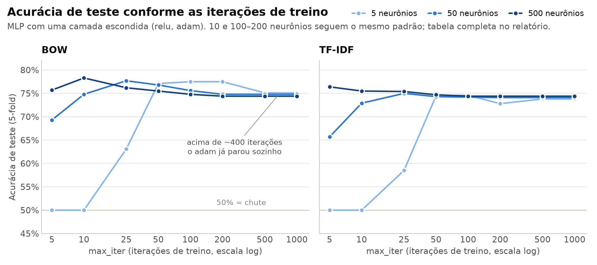
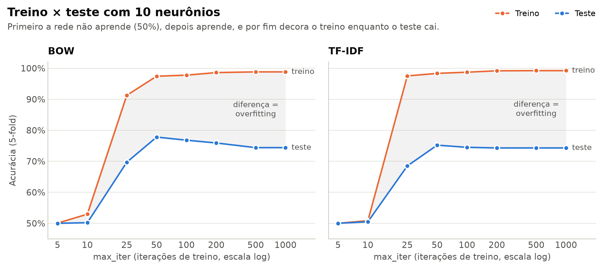
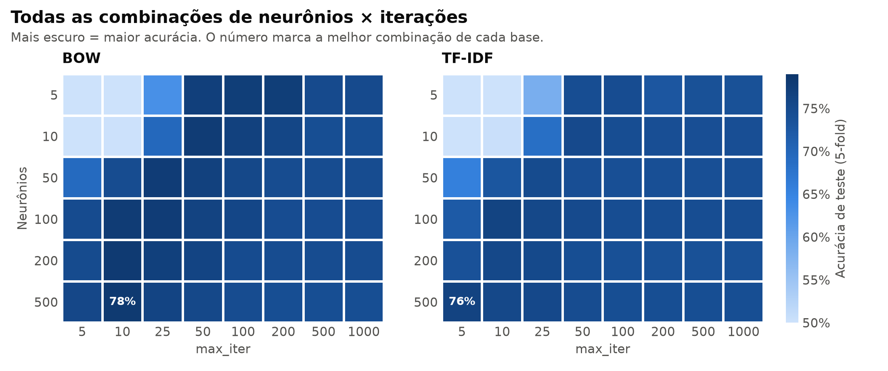

# Relatório: BOW e TF-IDF com MLP na base IMDB

## 1. Bases geradas

O arquivo `imdb_labelled.txt` tem 1000 frases de críticas de filmes, 500 positivas e 500 negativas. Os programas `src/bow.cpp` e `src/tf-idf.cpp` fazem o mesmo pré-processamento: passam o texto para minúsculas, tratam tudo que não é letra (números, pontuação, apóstrofos) como separador e descartam as palavras da lista em `src/stopwords.h`. Sobram 2566 palavras distintas, que viram as colunas das duas bases. A última coluna é o rótulo.

- `Imdb_BOW.csv`: 1 se a palavra aparece na frase, 0 se não aparece.
- `Imdb_TF-IDF.csv`: TF = ocorrências da palavra ÷ total de palavras da frase; IDF = log(N ÷ número de frases que contêm a palavra); o valor gravado é TF × IDF.

A primeira versão do tokenizador tinha um erro. Quando a palavra lida era uma stopword, ela não era apagada e ficava grudada na palavra seguinte: "a beautiful" virava `abeautiful`, "about it" virava `aboutit`. O vocabulário chegou a 5445 colunas, a maior parte lixo. Com a correção caiu para 2566, e a acurácia da MLP padrão (100 neurônios, 500 iterações, mesma semente) subiu de 0,698 para 0,746 no BOW e de 0,695 para 0,745 no TF-IDF. Também restauramos a linha 172 do arquivo original, onde "Zombiez" tinha virado "sz".

Mesmo limpa, a base é pequena e esparsa. Depois do pré-processamento a frase média tem 5,5 palavras (mediana 4), 1737 das 2566 palavras aparecem em uma única frase, 12 frases ficam vazias e 4 grupos de frases viram vetores idênticos com rótulos diferentes. Isso ajuda a explicar por que nem no treino a rede passa de 99,4%.

## 2. MLP nas duas bases

Configuração: uma camada escondida com 100 neurônios, ativação relu, otimizador adam, `max_iter=500`, validação cruzada 5-fold com a mesma divisão nas duas bases (`random_state=1`).

| Base   | Acurácia (média ± desvio) |
|--------|---------------------------|
| BOW    | 0,746 ± 0,012             |
| TF-IDF | 0,745 ± 0,030             |

As duas bases empatam nessa configuração.

## 3. Variando neurônios e iterações

Testamos 5, 10, 50, 100, 200 e 500 neurônios na camada escondida, combinados com `max_iter` de 5, 10, 25, 50, 100, 200, 500 e 1000. São 48 configurações por base, todas com o mesmo 5-fold.

Acurácia de teste, BOW (linhas: neurônios; colunas: `max_iter`):

| Neurônios | 5     | 10    | 25    | 50    | 100   | 200   | 500   | 1000  |
|-----------|-------|-------|-------|-------|-------|-------|-------|-------|
| 5         | 0,500 | 0,500 | 0,631 | 0,771 | 0,775 | 0,775 | 0,751 | 0,751 |
| 10        | 0,500 | 0,502 | 0,697 | 0,778 | 0,768 | 0,759 | 0,744 | 0,744 |
| 50        | 0,693 | 0,748 | 0,777 | 0,768 | 0,756 | 0,748 | 0,748 | 0,748 |
| 100       | 0,749 | 0,778 | 0,777 | 0,765 | 0,758 | 0,746 | 0,746 | 0,746 |
| 200       | 0,750 | 0,781 | 0,770 | 0,762 | 0,749 | 0,747 | 0,747 | 0,747 |
| 500       | 0,757 | 0,783 | 0,762 | 0,755 | 0,748 | 0,744 | 0,744 | 0,744 |

Acurácia de teste, TF-IDF:

| Neurônios | 5     | 10    | 25    | 50    | 100   | 200   | 500   | 1000  |
|-----------|-------|-------|-------|-------|-------|-------|-------|-------|
| 5         | 0,500 | 0,500 | 0,585 | 0,745 | 0,746 | 0,728 | 0,738 | 0,738 |
| 10        | 0,500 | 0,505 | 0,685 | 0,752 | 0,745 | 0,743 | 0,743 | 0,743 |
| 50        | 0,657 | 0,729 | 0,750 | 0,743 | 0,742 | 0,741 | 0,741 | 0,741 |
| 100       | 0,722 | 0,763 | 0,755 | 0,751 | 0,745 | 0,745 | 0,745 | 0,745 |
| 200       | 0,737 | 0,755 | 0,753 | 0,744 | 0,740 | 0,739 | 0,739 | 0,739 |
| 500       | 0,764 | 0,755 | 0,754 | 0,747 | 0,744 | 0,744 | 0,744 | 0,744 |

O notebook (`MLP_v1.ipynb`, seção "Tarefa 3") tem também a acurácia no treino e o número de épocas que cada rede realmente rodou. Os valores completos estão em `resultados_mlp.csv`.

Os mesmos resultados em gráficos (gerados na seção "Gráficos da Tarefa 3" do notebook):







O que as tabelas e os gráficos mostram:

**Poucas iterações com poucos neurônios não aprendem nada.** Com 5 ou 10 neurônios e até 10 épocas a acurácia fica em 0,50, que é o mesmo que chutar sempre a mesma classe. Redes maiores saem do lugar mais rápido: com 500 neurônios, 5 épocas já dão 0,757 no BOW e 0,764 no TF-IDF.

**O melhor resultado aparece cedo, entre 10 e 50 épocas.** O máximo foi 0,783 no BOW (500 neurônios, 10 épocas) e 0,764 no TF-IDF (500 neurônios, 5 épocas). Esses picos foram escolhidos olhando os mesmos folds usados para medir, então são um pouco otimistas, mas o padrão se repete em quase todas as linhas.

**Treinar mais piora o teste.** Depois de umas 50 épocas a acurácia de treino passa de 96% e chega a 99,4%, enquanto a de teste cai para perto de 0,745. A rede decora as 800 frases de treino. Com 2566 entradas, até a rede de 5 neurônios já tem cerca de 12.800 pesos, mais do que o necessário para memorizar essa quantidade de exemplos. Parar o treino cedo funciona como regularização.

**Acima de umas 400 iterações nada muda.** As colunas 500 e 1000 são idênticas porque o adam para sozinho quando a perda de treino passa 10 épocas seguidas sem melhorar (`n_iter_no_change=10`). Em média, as redes pararam entre 130 e 389 épocas no BOW e entre 92 e 309 no TF-IDF, e quanto mais neurônios, mais cedo elas param.

**Depois que a rede converge, o número de neurônios quase não importa.** Com `max_iter` de 500 ou 1000, quando todas as redes já pararam sozinhas, a acurácia fica entre 0,744 e 0,751 no BOW e entre 0,738 e 0,745 no TF-IDF, seja com 5 ou com 500 neurônios. O número de neurônios muda a velocidade com que a rede chega lá, não o ponto de chegada.

## 4. BOW × TF-IDF

O BOW ficou acima do TF-IDF em 40 das 48 configurações, empatou em 6 e perdeu em 2, com vantagem média de 0,014. A maior diferença (0,047) aparece em redes pequenas com poucas épocas. Com as redes treinadas até o fim (`max_iter` 500), a diferença fica entre 0 e 0,013, menor que a variação do TF-IDF entre folds (desvio de 0,025 a 0,037). Existe uma leve vantagem do BOW, mas pequena demais para dizer que uma representação é claramente melhor nesta base. O TF-IDF também variou mais de um fold para outro do que o BOW (desvio de 0,009 a 0,015).

O motivo é o tamanho das frases. Em 910 das 1000 frases nenhuma palavra se repete, então o TF de cada palavra é só 1 dividido pelo número de palavras da frase. O TF-IDF acaba guardando a mesma informação de presença e ausência que o BOW, apenas reescalada pelo IDF e pelo tamanho da frase. Como a MLP aprende um peso próprio para cada palavra, ela consegue compensar essa escala, e o IDF acrescenta pouco. O TF-IDF tende a fazer mais diferença em textos longos, em que a contagem das palavras varia, e em métodos que não aprendem pesos por palavra, como a similaridade de cosseno.

## 5. Conclusão

As duas bases chegam a cerca de 75% de acurácia com a MLP. O BOW fica um pouco à frente na maioria das configurações, mas dentro da margem de erro. O que mais mexeu no resultado foi o pré-processamento: corrigir a remoção de stopwords valeu uns 5 pontos. Variar neurônios e iterações mostrou que a rede aprende rápido e depois passa a decorar o treino. As melhores acurácias (0,76 a 0,78) aparecem com poucas épocas, e acima de umas 400 iterações o resultado não muda mais, porque o próprio adam encerra o treino.

## Como reproduzir

```
g++ -std=c++17 -O2 -o bow src/bow.cpp && ./bow imdb_labelled.txt
g++ -std=c++17 -O2 -o tfidf src/tf-idf.cpp && ./tfidf imdb_labelled.txt
```

Depois rode as seções "Tarefa 2" e "Tarefa 3" do `MLP_v1.ipynb` (a varredura leva uns 10 minutos).
